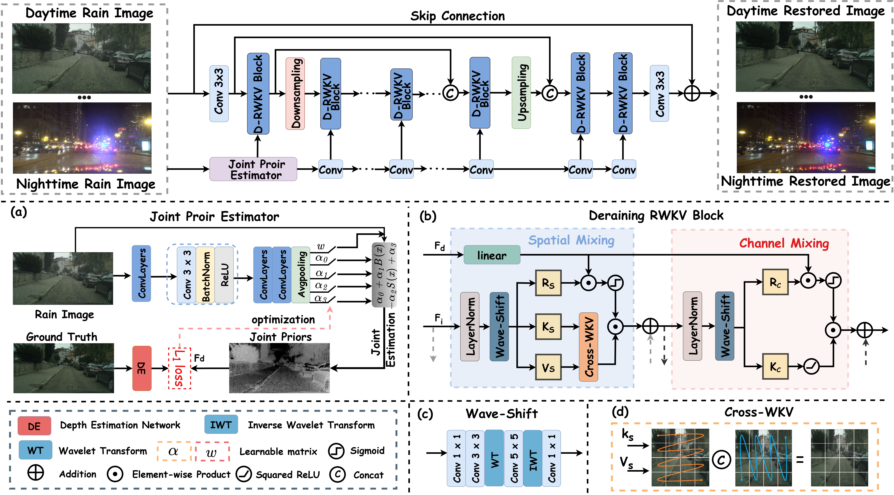

<!---
# Learning A Spiking Neural Network for Efficient Image Deraining
[](https://drive.google.com/drive/folders/1KRR_L276nviPT9JFPL9zfBiZVKJO6dM1?usp=drive_link)
[](https://pan.baidu.com/s/1TlgoslD-hIzySDL8l6gekw?pwd=pu2t)
--->
<div align="center">

# Unifying day and night: Towards all-time image deraining via joint prior representation learning
</div>

> <!--Learning A Spiking Neural Network for Efficient Image Deraining-->
> 
>  [Tianyu Song](https://scholar.google.com/citations?user=wA3Op6cAAAAJ&hl=zh-CN), Shumin Fan, [Xiang Chen](https://cschenxiang.github.io/), Naiyao Wang, Hongbo Liu, Ruili Wang
>
> <!--- Dalian Polytechnic University, Nanjing University of Science and Technology and Harbin Institute of Technology-->
>
> <!--Primary contact: Tianyu Song(songtienyu@163.com)-->
>
> Welcome to visit our website(专注底层视觉领域的信息服务平台) for low-level vision: https://www.lowlevelcv.com
> 
> **Abstract:** 
Existing deep learning–based image deraining methods largely rely on implicit feature learning and often neglect the intrinsic coupling between rain degradation and the imaging environment, leading to poor generalization across diverse illumination conditions, especially between daytime and nighttime scenes. We introduce all-time image deraining (ATID), a unified task for restoring rain-degraded images under both daytime and nighttime conditions, and propose ATID-Net, a prior representation–guided network for this task. Central to our approach is the joint prior estimator (JPE), which disentangles depth and illumination cues from the input image and injects them into the restoration backbone to guide feature learning in a condition-aware manner. To effectively model complex rain patterns, ATID-Net adopts an improved Receptance Weighted Key Value (RWKV) backbone, in which Wave-Shift and Cross-WKV are introduced to enhance local frequency modeling and global spatial interaction with linear computational complexity. Furthermore, we construct AT-Rain, a high-fidelity all-time deraining dataset synthesized via depth–illumination and near–far fusion strategies, significantly narrowing the synthetic-to-real domain gap. Extensive experiments on synthetic and real-world benchmarks demonstrate that ATID-Net achieves superior deraining performance, establishing a robust unified baseline for ATID. The code will be released.
>
> 

# 🔥 Dataset pipeline


# ✨Network  Architecture




## News
<!---
- **July 4, 2025:** Paper submitted.
- **Sep 13, 2023:** The basic version is released, including codes, pre-trained models on the Sate 1k dataset, and the used dataset.
- **Sep 14, 2023:** RICE dataset updated.
  ** Sep 15, 2023:** The [visual results on Sate 1K](https://pan.baidu.com/s/1dToHnHI9GVaHQ3-I6OIbpA?pwd=rs1k) and [real-world dataset RSSD300](https://pan.baidu.com/s/1OZUWj8eo6EmP5Rh8DE1mrA?pwd=8ad5) are updated.-->

### Install

We test the code on PyTorch 1.9.1 + CUDA 11.8 + cuDNN 8.9.6.

1. Create a new conda environment
```
conda create -n ATIDNet python=3.8
conda activate ATIDNet
```

2. Install dependencies
```
pip install torch==1.9.1+cu118 torchvision==0.10.1+cu118 torchaudio==0.9.1 -f https://download.pytorch.org/whl/torch_stable.html

pip install matplotlib scikit-image opencv-python numpy einops math natsort tqdm lpips time tensorboardX
```

### Download

You can download the pre-trained models and datasets on BaiduPan.

The final file path should be the same as the following:

```
┬─ pretrained_models
│   ├─ ATID.pth
│   ├─ Realrain_1k_H.pth
│   ├─ ... (model name)
│   └─ ... (exp name)
└─ data
    ├─ ATID
    ├─ Realrain_1k_H
    │├─ train
    ││  ├─ input
    ││  │  └─ ... (image filename)
    ││  │  └─ target
    ││  │  └─ ... (corresponds to the former)
    │└─ test
    │    └─ ...
    └─ ... (dataset name)

```
### 🛠️ Training, Testing and Evaluation

### Train
The training code will be released after the paper is accepted.
You should change the path to yours in the `Train.py` file.  Then run the following script to test the trained model:

```sh
python train.py
```

### Test
You should change the path to yours in the `Test.py` file.  Then run the following script to test the trained model:

```sh
python test.py
```


### Evaluation
You should change the path to yours in the `dataset_load.py` file.  Then run the following script to test the trained model:

```sh
python evaluation.py
```
It is recommended that you can download the visual deraining results and retest the quantitative results on your own device and environment.


### 🚀 Visual Results

<table>
<thead>
  <tr>
    <th>Dataset</th>
    <th>Daytime</th>
    <th>Nighttime</th>
    <th>RealRain-1k-H</th>
    <th>RealRain-1k-L</th>
    <th>GTAV-NightRain</th>
  </tr>
</thead>
<tbody>
  <tr>
    <td>Baidu Cloud</td>
    <td align="center"> <a href="https://pan.baidu.com/s/1ch1H426nQGhRzHZDnF0NAA?pwd=khah 提取码：khah">Download</a> </td>
    <td align="center"> <a href="https://pan.baidu.com/s/12zgi3x8YY_ZPfI6sfGgMRQ?pwd=l5rn 提取码：l5rn">Download</a> </td>
    <td align="center"> <a href="https://pan.baidu.com/s/19TkwD-XzDAIp46145wmzpw?pwd=5uw9 提取码：5uw9">Download</a> </td>
    <td align="center"> <a href="https://pan.baidu.com/s/1xT7pMxESXcMnNL72ihbiuw?pwd=v9xc 提取码：v9xc">Download</a> </td>
    <td align="center"> <a href="https://pan.baidu.com/s/1rerYW9VbEweyaVvQpO7NAA?pwd=dt70 提取码：dt70">Download</a> </td>
  </tr>
</tbody>
</table>


## 🚨 Notes

1. Send e-mail to songtienyu@163.com if you have critical issues to be addressed.
2. Please note that there exists the slight gap in the final version due to errors caused by different testing devices and environments. 
3. Because the synthetic dataset is not realistic enough, the trained models may not work well on real world datasets.


## 👍 Acknowledgment

This code is based on the [Restormer](https://github.com/swz30/Restormer), [spikingjelly](https://github.com/fangwei123456/spikingjelly) and [C2PNet](https://github.com/YuZheng9/C2PNet). Thanks for their awesome work.
